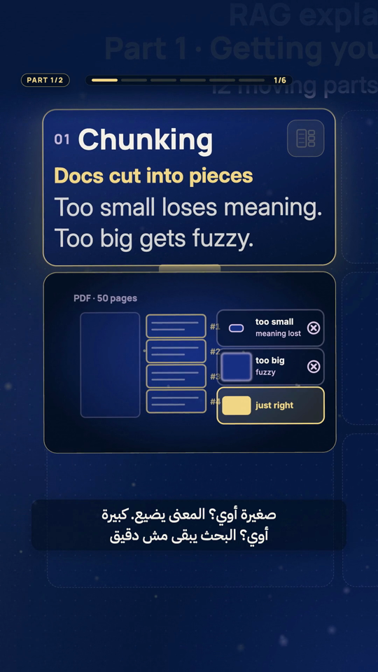
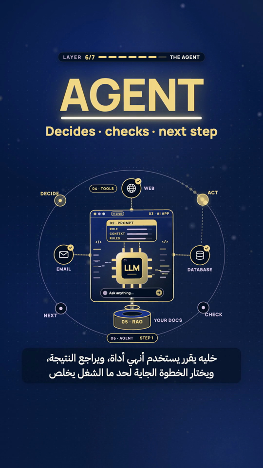
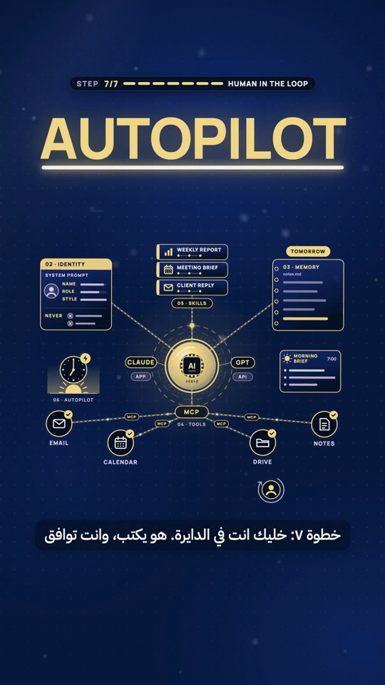
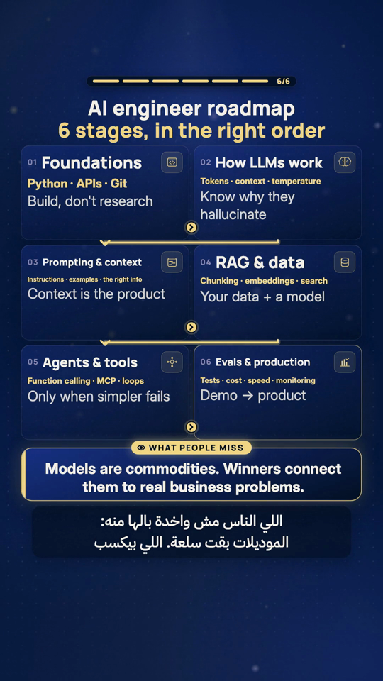

# Claude Motion Studio

**Turn Claude into a motion-graphics studio.**
Give it a topic and a voice-over. Get back a finished 9:16 reel: animated explainer cards or one evolving scene, kinetic words timed to the voice, Arabic or English captions, a mixed and loudness-matched soundtrack, and an MP4 that uploads to Instagram and TikTok without fixes.

<p align="center">
  
  
  
</p>

This is not a prompt pack. It is the working method behind a real series of 15 finished reels: the formats, the numbers, the checks and the mistakes we already paid for, written so Claude can follow them end to end.

---

## What it can do

| | Capability | You say | You get |
|---|---|---|---|
| 1 | **Cheat-sheet reels** | "Explain RAG in 6 cards" | A grid of glass cards built one by one; the camera whips from card to card and each card plays a mini-explainer, then pulls back to a full, saveable sheet |
| 2 | **Build-up reels** | "Show how an AI app is built, layer by layer" | One continuous scene, no cuts: a central object gains a layer on every beat while the camera pulls back |
| 3 | **Kinetic typography** | "Make the key words hit on the voice" | One big word at a time, landing on the exact spoken frame, with masks, underline sweeps and emphasis pops |
| 4 | **Arabic and RTL captions** | "Arabic subtitles, Egyptian dialect" | Two-line max captions with correct RTL, English terms embedded cleanly, long lines split and re-timed automatically |
| 5 | **Voice-over to timeline** | "Here is my VO, sync everything" | Word timestamps, a cue sheet in JSON, every visual tied to a word |
| 6 | **Finish and ship** | "Export for Instagram" | Ducked music, quiet SFX, −14 LUFS master, fast-start H.264 in BT.709, plus a QC pass with frame sheets |

Works with **Remotion** (React video, the default engine) and can drive **Adobe After Effects** through ExtendScript when that is where the project lives.

---

## Install in 30 seconds

1. Download this repository (green **Code** button → **Download ZIP**) and unzip it.
2. Copy the `claude-motion-studio` folder into one of:
   - `~/.claude/skills/` to use it in every project, or
   - `.claude/skills/` inside one project.
3. Start Claude Code and ask for a reel. The skill loads by itself when the request is about motion graphics, reels, kinetic text or video export.

You will want, on your machine: Node 18+, `ffmpeg`, and a Whisper build (any: openai-whisper, faster-whisper or whisper.cpp) for word timestamps. A TTS voice is optional; your own recording works just as well.

---

## Try it

```
Make a 60-second cheat-sheet reel that explains how RAG works in 6 cards.
English voice-over, Arabic subtitles, end with "Comment RAG".
```

```
Build-up reel, 75 seconds: "Build your AI assistant in 7 steps".
One glowing orb in the middle, each step docks onto it on its spoken word.
```

```
Here is vo.wav. Transcribe it with word timestamps, write episode.json,
then render and run the full QC checklist before you show me anything.
```

Fifteen more in [`prompts/example-prompts.md`](prompts/example-prompts.md).

---

## Gallery

All stills are frames from finished reels made with this method (1080×1920, shown at half size).

| | | |
|---|---|---|
|  |  |  |
| Card zoom + drawer explainer | Pull-back to the full sheet, keyword CTA | Build-up: the agent layer docks |
|  |  |  |
| Kinetic word on the spoken frame | Build-up: seven parts, one scene | Insight panel over the finished roadmap |

---

## What's inside

```
claude-motion-studio/
  SKILL.md                      router + end-to-end pipeline (Claude reads this first)
  recipes/
    cheat-sheet-reel.md         card-grid explainer format
    build-up-reel.md            one evolving object, a layer per beat
    kinetic-typography.md       word timing, masks, emphasis
    arabic-rtl-captions.md      RTL, mixed scripts, 2-line rule, auto-split
    voiceover-and-timing.md     TTS → word timestamps → cue JSON
    after-effects-scripting.md  driving After Effects from Claude
    audio-and-export.md         ducking, SFX, two-pass −14 LUFS, platform encode
    qc-checklist.md             what to check before anyone sees it
  templates/
    episode.schema.json         the episode format, documented
    episode.example.json        a real episode file (83.6 s build-up reel)
    remotion-starter.md         scaffold + component structure
  prompts/example-prompts.md    15 copy-paste prompts
  gallery/                      stills from finished reels
```

The idea in one line: **the voice-over is the clock.** Every visual event is a word time in a JSON file, so the same engine renders every episode, and a re-recorded voice only means new numbers.

---

## Credits

Created by **Maged El-Gohary**. Method, formats, templates and checklists come from building a weekly English/Arabic AI-explainer reel series with Claude Code.

Released under the [MIT License](LICENSE). Use it, fork it, ship reels with it. A mention is appreciated.
