# Claude Motion Studio

**Every kind of motion graphics, from one prompt — and the proof for each one.**

<table>
  <tr>
    <td><a href="demos/06-3d-threejs">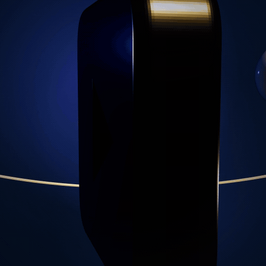</a></td>
    <td><a href="demos/03-morph-liquid">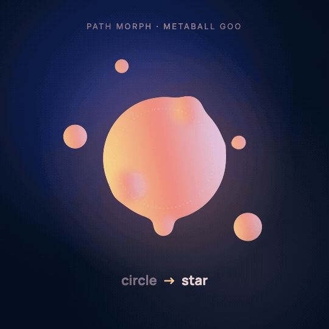</a></td>
    <td><a href="demos/08-camera-moves">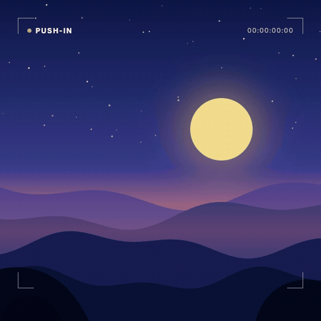</a></td>
  </tr>
  <tr>
    <td><a href="demos/02-arabic-rtl-type">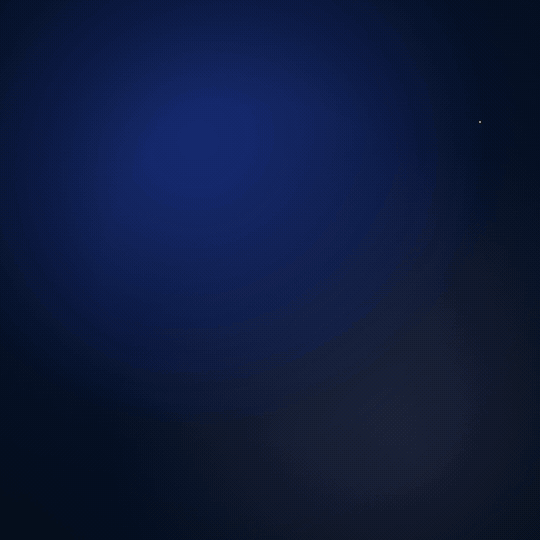</a></td>
    <td><a href="demos/11-audio-reactive">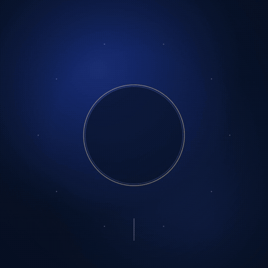</a></td>
    <td><a href="demos/14-html-gsap"></a></td>
  </tr>
</table>

A Claude skill that turns Claude Code into a motion studio across **every engine that matters** — Remotion, HTML + GSAP, pure SVG, Lottie, Three.js, canvas particles and After Effects — with a router that picks the right one, a production loop that inspects its own frames, and 16 rendered demos. Each demo below was built with the engine it claims, and each comes with the exact prompt, its source, and a recipe.

---

## 16 capabilities, 16 real renders

Click a GIF for the full MP4, the source and the prompt. All demos are 1080×1080, 4.6–6.6 s, original work.

| | Demo | Capability · engine | The exact prompt | Recipe |
|---|---|---|---|---|
| 01 | <a href="demos/01-kinetic-typography">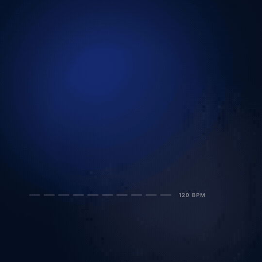</a> | **Kinetic typography** · Remotion | *Kinetic typography, 5 s square, 120 BPM: "Every word lands on the beat." One word per beat, rising from a mask; slam "lands" with motion blur; collapse the tracking on "beat." in gold with an underline; show the beat as a row of ticks. Camera drifts in.* | [01](recipes/01-kinetic-typography.md) |
| 02 | <a href="demos/02-arabic-rtl-type"></a> | **Arabic / RTL type with English terms** · Remotion | *Arabic kinetic title, 5 s square: «الموشن جرافيك» / «بقى بـ Prompt واحد». Reveal each Arabic word with a right-to-left wipe (never per letter), type "Prompt" LTR inside a gold chip, underline «واحد» right-to-left, draw an RTL arrow and three info pills.* | [02](recipes/02-arabic-rtl.md) |
| 03 | <a href="demos/03-morph-liquid"></a> | **Shape morph & liquid** · Remotion + SVG (flubber, goo filter) | *Morph a liquid shape circle → star → squircle → blob → circle with flubber, inside an SVG goo filter so 7 orbiting droplets merge and split from it. Gold-coral-lavender gradient, 5 s, label each morph.* | [03](recipes/03-shape-morph-liquid.md) |
| 04 | <a href="demos/04-svg-line-draw">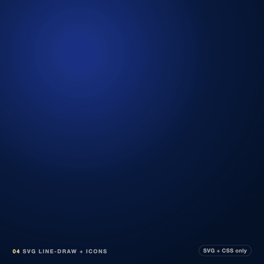</a> | **SVG line-draw + icons** · SVG + CSS only, captured in headless Chrome | *Pure SVG, no JavaScript: 6 icon tiles whose strokes draw on with pathLength=1 stagger, gold accents pop with a back-out ease, then a wire connects them and a glowing spark travels it, lighting each tile. Render it with headless Chrome.* | [04](recipes/04-svg-line-draw.md) |
| 05 | <a href="demos/05-data-viz">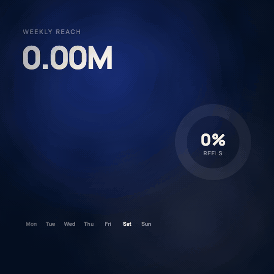</a> | **Data visualization** · Remotion + d3-shape / d3-scale | *Animated dashboard, 5 s: a KPI counter to 1.84M with a +48% chip, 7 staggered bars with a soft overshoot, a dotted monotone trend line drawn left to right, a tooltip on the best day, and a donut that sweeps 62/24/14. Use d3-shape and d3-scale.* | [05](recipes/05-data-viz.md) |
| 06 | <a href="demos/06-3d-threejs"></a> | **3D scene** · Three.js via @remotion/three | *Three.js in Remotion: an extruded, bevelled play-badge in glossy indigo with gold bevels, studio reflections without HDR files, an orbit ring and pearls, camera dollies in and orbits over 5 s. Everything driven by the frame number.* | [06](recipes/06-3d-threejs.md) |
| 07 | <a href="demos/07-particles"></a> | **Particles & generative** · Remotion + canvas + noise | *Generative flow field: 1,700 particles following simplex noise, each with a short fading trail and a lifetime, swirling around a glowing orb that wanders across the frame. Deterministic per frame, colours by speed.* | [07](recipes/07-particles-generative.md) |
| 08 | <a href="demos/08-camera-moves"></a> | **Camera moves** · Remotion + motion-blur | *Camera language demo: a layered dusk landscape with push-in and parallax truck, then a whip-pan with real motion blur to a night scene titled "One camera. Always moving.", settling with a pull-back. Viewfinder HUD naming each move.* | [08](recipes/08-camera-moves.md) |
| 09 | <a href="demos/09-ui-mockup">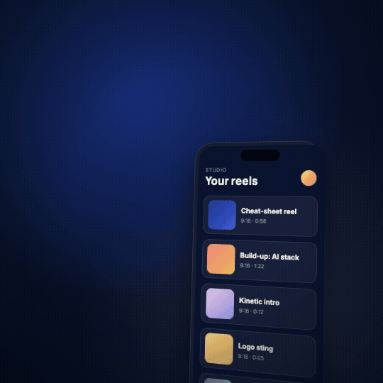</a> | **UI / product mockup** · Remotion | *Phone UI demo: a list scrolls with momentum under a finger, tap a card, it expands into the detail screen (shared element), tap Render, a progress bar fills, then a success toast. Step list on the left lights in sync.* | [09](recipes/09-ui-mockup.md) |
| 10 | <a href="demos/10-logo-reveal">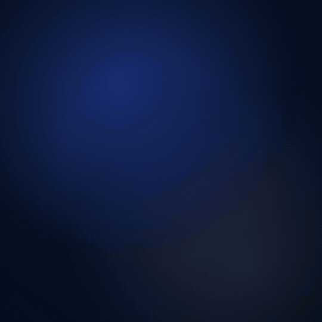</a> | **Logo reveal** · Remotion + SVG | *Logo reveal for an original rounded-square play mark: gold stroke draws on, a liquid gold fill rises inside, flash + shockwave + sparks, a glint sweeps across, then "MOTION STUDIO" letters rise with blur while the tracking settles.* | [10](recipes/10-logo-reveal.md) |
| 11 | <a href="demos/11-audio-reactive"></a> | **Audio-reactive** · Remotion + media-utils (beat synthesized) | *Audio-reactive visualizer on a 6-second beat: 72 radial bars from the FFT of each frame (normalised per band), a core orb that pulses on the kick, sparks on the hats, and a scrolling waveform. Synthesize the beat yourself.* | [11](recipes/11-audio-reactive.md) |
| 12 | <a href="demos/12-transitions">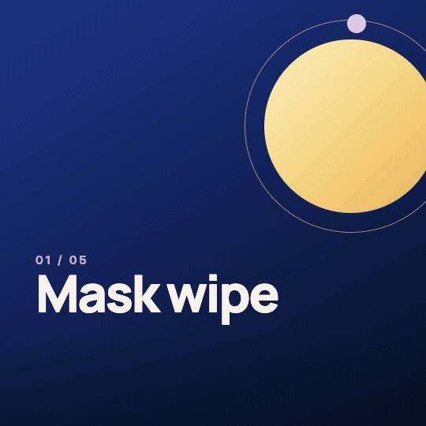</a> | **Transitions pack** · @remotion/transitions, custom presentations | *Transitions pack: 5 cards joined by four custom transitions — diagonal mask wipe with a gold edge, zoom-through with blur, 6-strip slice, and an iris with a riding ring. Each card names the transition that leaves it.* | [12](recipes/12-transitions.md) |
| 13 | <a href="demos/13-lottie"></a> | **Lottie written by code** · Lottie JSON + @remotion/lottie | *Write a Lottie JSON by code (no After Effects): a ring that draws, a gold disc that pops, a check that draws, an 8-ray burst made with a repeater, confetti, and a turning dashed halo. Play it frame-accurately in Remotion and label each Lottie feature as it plays.* | [13](recipes/13-lottie-by-code.md) |
| 14 | <a href="demos/14-html-gsap"></a> | **HTML + GSAP scene** · GSAP 3, captured by seeking in headless Chrome | *Build an HTML + CSS + GSAP scene: split-character headline "Ship the motion.", glass cards flying in from depth with a stagger, then fanning with back.out, a timeline scrubber with label markers. Capture it frame by frame with headless Chrome by seeking the timeline.* | [14](recipes/14-html-gsap.md) |
| 15 | <a href="demos/15-vo-captions"></a> | **Captions synced to a voice-over** · local Whisper + Remotion | *Take the first 6.6 s of my VO, get word timestamps with local Whisper, and build captions: a highlight pill that slides word to word, "Claude." in gold, strike-throughs on "editor", "timeline" and "keyframes", and a word-block timeline with a playhead underneath.* | [15](recipes/15-vo-captions.md) |
| 16 | <a href="demos/16-after-effects">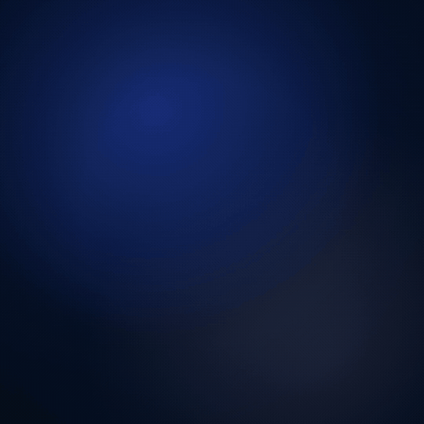</a> | **After Effects script** · ExtendScript (.jsx) + Remotion re-creation | *Write an After Effects ExtendScript that builds a title-card comp from titlecard.json (solid, ring, dot, accent line, two text layers, all keyframes with a 75 % ease), and re-create the same comp in Remotion from the same JSON with an AE-style keyframe timeline.* | [16](recipes/16-after-effects.md) |

Demo 16 is labelled "what this script builds": After Effects cannot be screen-recorded headless, so the video is a Remotion re-creation that reads the **same JSON** as the `.jsx` and maps AE's ease 1:1. Run the script in AE for the real comp.

---

## Install in 30 seconds

1. Download this repository (**Code → Download ZIP**) and unzip it.
2. Copy the folder into `~/.claude/skills/` (every project) or `<project>/.claude/skills/` (one project), and name it `claude-motion-studio`.
3. Ask Claude Code for motion: *"Make a 5-second logo reveal for my SVG"*, *"Turn this landing page into a 9:16 video"*, *"Arabic captions on this VO"*. The skill loads by itself.

What you need on your machine, per engine:

| For | Install |
|---|---|
| Remotion demos and reels | Node 18+, a Remotion project (`npx create-video@latest`), `ffmpeg` |
| HTML/GSAP and SVG capture | Playwright Chromium (`npx playwright install chromium`) |
| 3D / Lottie / data | `@remotion/three` + `three`, `@remotion/lottie` + `lottie-web`, `d3-shape` + `d3-scale` |
| Word timestamps | any Whisper with word timestamps (mlx-whisper, openai-whisper, faster-whisper, whisper.cpp) |
| After Effects | After Effects with scripting enabled (optional) |
| The synthesized beat | Python 3 + numpy (optional) |

Pin every `remotion` / `@remotion/*` package to the same exact version.

---

## What makes it different

- **Every engine, one router.** Most motion skills teach one tool (usually Remotion). This one decides *which* tool fits — Remotion, HTML/GSAP, SVG, Lottie, Three.js, canvas or After Effects — and has a tested recipe for each ([`SKILL.md`](SKILL.md)).
- **Proof, not promises.** Each capability ships a rendered demo made with the engine it names, the exact prompt, and its source.
- **Deterministic by design.** Everything is a function of the frame (or a seekable timeline): HTML is captured by *seeking* GSAP, particles re-simulate with seeded noise, 3D cameras are computed per frame. Renders are reproducible and parallel-safe.
- **Arabic done right.** RTL layout, whole-word reveals that never break letter joining, isolated English terms, two-line caption rules with auto-split.
- **The voice is the clock.** Word timestamps from local Whisper drive captions, kinetic words and cues; nothing is hand-timed.
- **It checks its own work.** Stills before rendering, contact sheets after, loudness and encode checks, GIF size budgets — and a record of the mistakes each check exists for.
- **Shipping included.** −14 LUFS two-pass master, BT.709, fast-start MP4s for Instagram/TikTok/Shorts, and small GIF previews from a dedicated master.

---

## Proof: a real published series

The reel formats in this skill (cheat-sheet and build-up) come from a weekly English/Arabic AI-explainer series made end to end with Claude Code.

| | | |
|---|---|---|
| 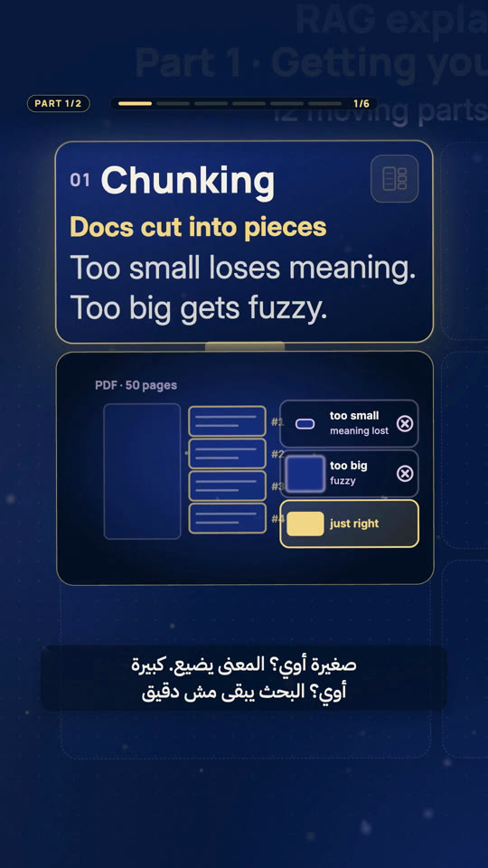 | 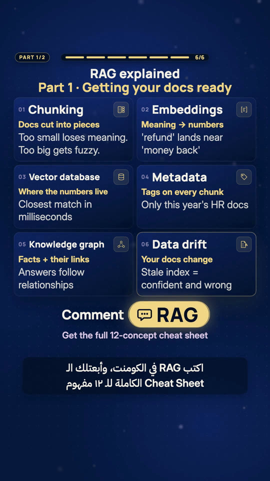 | 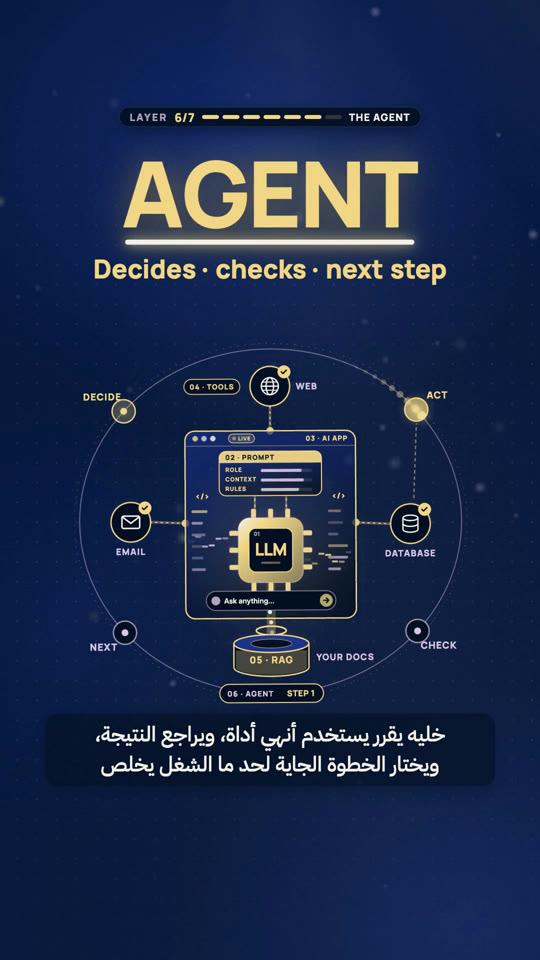 |
| Card zoom + drawer explainer | Pull-back to the full sheet, keyword CTA | Build-up: the agent layer docks |
| 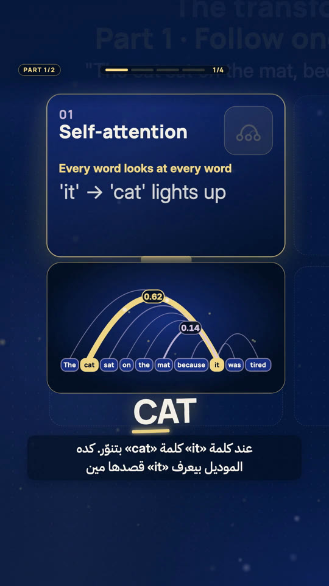 | 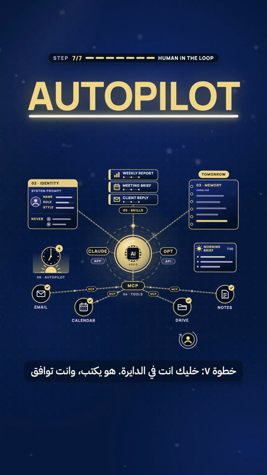 |  |
| Kinetic word on the spoken frame | Seven parts, one scene | Insight panel over the finished roadmap |

---

## What's inside

```
claude-motion-studio/
  SKILL.md                    engine router, request router, production loop, house rules
  recipes/
    01-kinetic-typography.md … 16-after-effects.md   one per capability
    reel-cheat-sheet.md  reel-build-up.md           the two reel formats
    audio-and-export.md  qc-checklist.md            mix, master, encode, GIFs, QC
  demos/NN-name/              demo.gif · demo.mp4 · poster.png · prompt.md · source
  templates/
    demo-kit/                 theme + backdrop, Root/entry, capture.mjs (headless seek), export.sh, sheet.sh
    remotion-starter.md  episode.schema.json  episode.example.json
  examples/prompts.md         30 copy-paste prompts
  gallery/                    stills from the published series
```

---

## Credits

Created by **Maged El-Gohary**. Method, recipes, demos, music and code are original work made with Claude Code.

Built on: [Remotion](https://www.remotion.dev) (free for individuals and small teams — check its license for company use), [GSAP](https://gsap.com) (loaded from its CDN, not redistributed), [Three.js](https://threejs.org), [lottie-web](https://github.com/airbnb/lottie-web), [flubber](https://github.com/veltman/flubber), [d3](https://d3js.org), [Playwright](https://playwright.dev), [ffmpeg](https://ffmpeg.org), [Whisper](https://github.com/openai/whisper) / [mlx-whisper](https://github.com/ml-explore/mlx-examples). Fonts: Manrope, Inter, IBM Plex Sans Arabic (SIL OFL).

Related skills worth knowing (no code or text from them is used here): [remotion-dev/skills](https://github.com/remotion-dev/skills) (official Remotion skills), [haidrrrry/claude-remotion-skill](https://github.com/haidrrrry/claude-remotion-skill), [imMamdouhaboammar/motion-graphics-skills](https://github.com/imMamdouhaboammar/motion-graphics-skills), [howseen-ai/claude-motion-design](https://github.com/howseen-ai/claude-motion-design), [iart-ai/web-animation-skills](https://github.com/iart-ai/web-animation-skills), video-shotcraft, hyperframes-motion-reel, and the awesome-claude-video-skills list.

Released under the [MIT License](LICENSE). Use it, fork it, ship motion with it. A mention is appreciated.
