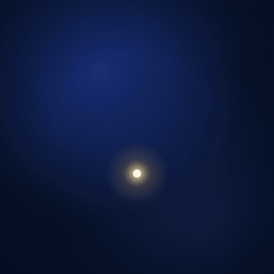

# 07 · Particles & generative

**Engine:** Remotion + canvas 2D + @remotion/noise  
**Recipe:** [`recipes/07-particles-generative.md`](../../recipes/07-particles-generative.md)



## The prompt
```
Generative flow field: 1,700 particles following simplex noise, each with a short fading trail
and a lifetime, swirling around a glowing orb that wanders across the frame. Deterministic per
frame, colours by speed.
```

## What to look for
Every frame re-simulates from frame 0 with seeded randomness, so parallel renders are identical. The GIF preview uses 1,000 particles and a 3.6 s loop to fit 2.5 MB; the MP4 is the full piece.

## Files
- `demo.mp4` — the full demo (H.264, 1080×1080)
- `demo.gif` — 540 px preview
- `poster.png` — still
- `D07Particles.tsx` — source

## Render it yourself
Copy `templates/demo-kit/` into a Remotion project as `lib/` (theme, Stage) plus `Root.tsx` and `index.ts`, put this demo's source under `demos/`, then:
```bash
npx remotion render index.ts MS07-particles out.mp4
```
