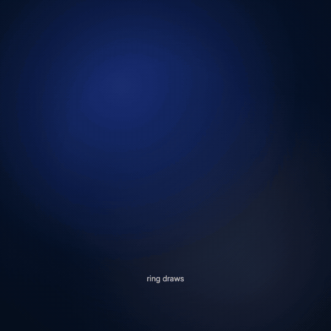

# 13 · Lottie by code

**Engine:** Lottie JSON written by lottie/make-lottie.mjs, played with @remotion/lottie  
**Recipe:** [`recipes/13-lottie-by-code.md`](../../recipes/13-lottie-by-code.md)



## The prompt
```
Write a Lottie JSON by code (no After Effects): a ring that draws, a gold disc that pops, a check
that draws, an 8-ray burst made with a repeater, confetti, and a turning dashed halo. Play it
frame-accurately in Remotion and label each Lottie feature as it plays.
```

## What to look for
success.json (11 KB) is a normal Lottie: drop it into lottie-web, LottieFiles or a mobile app. The chips show which Lottie feature is animating.

## Files
- `demo.mp4` — the full demo (H.264, 1080×1080)
- `demo.gif` — 540 px preview
- `poster.png` — still
- `D13Lottie.tsx` — source
- `lottie/make-lottie.mjs` — source
- `lottie/success.json` — source

## Render it yourself
Copy `templates/demo-kit/` into a Remotion project as `lib/` (theme, Stage) plus `Root.tsx` and `index.ts`, put this demo's source under `demos/`, then:
```bash
npx remotion render index.ts MS13-lottie out.mp4
```

Regenerate the animation: `node lottie/make-lottie.mjs`.
