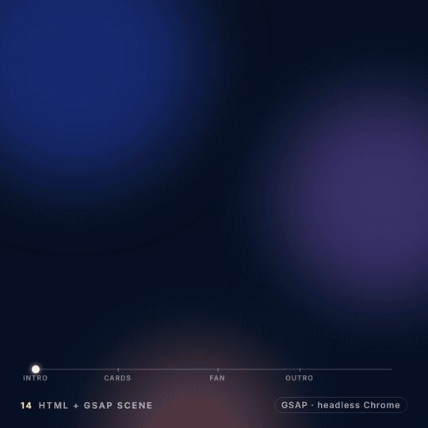

# 14 · HTML + GSAP scene

**Engine:** HTML/CSS + GSAP 3, captured frame-by-frame in headless Chromium  
**Recipe:** [`recipes/14-html-gsap.md`](../../recipes/14-html-gsap.md)



## The prompt
```
Build an HTML + CSS + GSAP scene: split-character headline "Ship the motion.", glass cards
flying in from depth with a stagger, then fanning with back.out, a timeline scrubber with label
markers. Capture it frame by frame with headless Chrome by seeking the timeline.
```

## What to look for
Open index.html: it plays live. For video, the capture tool calls window.__seek(t) per frame — no real-time recording.

## Files
- `demo.mp4` — the full demo (H.264, 1080×1080)
- `demo.gif` — 540 px preview
- `poster.png` — still
- `index.html` — source

## Render it yourself
```bash
node templates/demo-kit/capture.mjs demos/14-html-gsap/index.html frames 5 30   # from the repo root
ffmpeg -framerate 30 -i frames/f%04d.png -pix_fmt yuv420p out.mp4
```
(`capture.mjs` serves GSAP from your local `node_modules` instead of the CDN during capture.)
