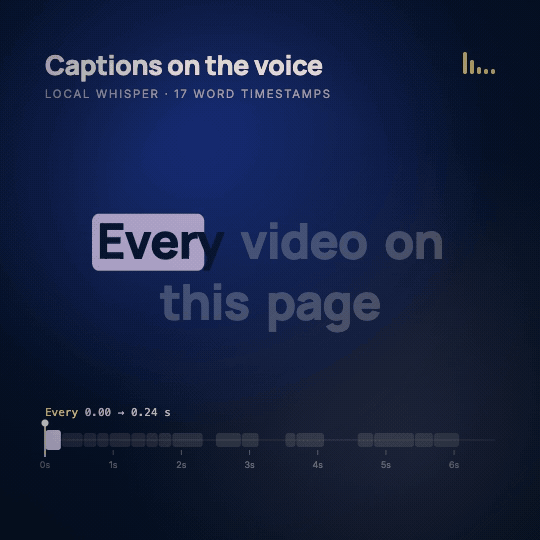

# 15 · Captions synced to VO

**Engine:** local Whisper (mlx-whisper) + Remotion  
**Recipe:** [`recipes/15-vo-captions.md`](../../recipes/15-vo-captions.md)



## The prompt
```
Take the first 6.6 s of my VO, get word timestamps with local Whisper, and build captions:
a highlight pill that slides word to word, "Claude." in gold, strike-throughs on "editor",
"timeline" and "keyframes", and a word-block timeline with a playhead underneath.
```

## What to look for
Turn the sound on. captions_words.json is the raw Whisper output (17 words); every highlight, strike and block comes from it.

## Files
- `demo.mp4` — the full demo (H.264, 1080×1080)
- `demo.gif` — 540 px preview
- `poster.png` — still
- `D15Captions.tsx` — source
- `captions_words.json` — source

## Render it yourself
Copy `templates/demo-kit/` into a Remotion project as `lib/` (theme, Stage) plus `Root.tsx` and `index.ts`, put this demo's source under `demos/`, then:
```bash
npx remotion render index.ts MS15-captions out.mp4
```

Word timestamps: `mlx_whisper vo.wav --model mlx-community/whisper-large-v3-turbo --word-timestamps True --output-format json` (any Whisper with word timestamps works).
